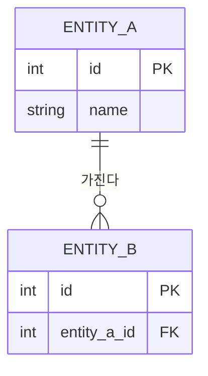

# 문서 템플릿 A — 분석·설계 (요구사항정의서·분석·아키텍처·기술스택·기능요건·ERD·화면기획서·API)

> 역할: 분석·설계 단계 주문형 문서의 머리 정보와 최소 목차를 정한다. 카탈로그 전체는 `CATALOG.md` 를 본다.
> 사용법: 해당 절의 `~~~markdown` 블록을 복사해 권장 위치에 만들고, `{{PROJECT}}`·`{{DATE}}` 와 `<…>` 를 채운다.
> 공통: 머리에 상태·최종 갱신일, 300줄 초과 시 `_부록/`, 값(주소·포트·계정)은 INFRA.md 참조만 적는다.

---

## 1. 요구사항정의서 (requirements)

| 항목 | 값 |
|---|---|
| 카탈로그 키 | `requirements` |
| 권장 위치 | `plan/00_요구사항/02_요구사항정의서.md` |
| 생성 시점 | 주문형 — 요구가 2건 이상 확정될 때(product 프로파일은 init) |
| 갱신 주체 | oplan(요구 추가·변경), odone_docs(상태) |
| 최소 목차 | 개요 · 요구 목록(REQ-ID·요구·출처·우선순위·수용기준·상태·관련 FN/TC) · 변경 기록 |

~~~markdown
# {{PROJECT}} 요구사항정의서

> 상태: 초안 · 최종 갱신일: {{DATE}} · 원문: `00_요구사항/01_사용자요구사항_원문.md`

## 1. 개요
- 목적: <이 시스템이 해결할 문제 1~2줄>
- 범위: `02_범위_일정/01_개발범위.md` 참조

## 2. 요구 목록
| REQ-ID | 요구 | 출처(원문 일자) | 우선순위(필수·권장·선택) | 수용기준 | 상태(제안·확정·구현·검증·보류) | 관련 FN/TC |
|---|---|---|---|---|---|---|
| REQ-01 | <요구> | <YYYY-MM-DD> | 필수 | <측정 가능한 기준 또는 AC ID> | 제안 | FN-01 / TC-01 |

## 3. 변경 기록
| 일자 | REQ-ID | 변경 | 근거(ADR·D-ID) |
|---|---|---|---|
~~~

---

## 2. 분석 문서 (analysis)

| 항목 | 값 |
|---|---|
| 카탈로그 키 | `analysis` |
| 권장 위치 | `plan/01_분석/NN_<주제>.md` |
| 생성 시점 | 주문형 — 현황·기존 시스템·외부 조사를 수행한 사이클 |
| 갱신 주체 | oplan |
| 최소 목차 | 질문 · 방법(재실행 가능한 측정 명령) · 결과 · 출처 · 결론 |

~~~markdown
# <주제> 분석

> 상태: 초안 · 최종 갱신일: {{DATE}}

## 1. 질문
## 2. 방법 — 재실행 명령: `<test/ 또는 tools/ 경로의 스크립트와 인자>`
## 3. 결과 (실측 수치는 측정 명령과 함께, 추정은 "(추정)" 표기)
## 4. 출처 (외부 정보 URL)
## 5. 결론 · 후속(관련 REQ-ID·D-ID·ADR)
~~~

---

## 3. 아키텍처 설계 (architecture)

| 항목 | 값 |
|---|---|
| 카탈로그 키 | `architecture` |
| 권장 위치 | `plan/03_아키텍처/01_아키텍처_설계.md` |
| 생성 시점 | 주문형 — 구조 결정(계층·모듈·배치)이 처음 생긴 사이클 |
| 갱신 주체 | oplan(구조 결정 시), 결정 근거는 ADR |
| 최소 목차 | 구성도 · 계층 · 의존 규칙 · 품질 속성 · 제약 · 관련 ADR |

~~~markdown
# {{PROJECT}} 아키텍처 설계 (to-be)

> 상태: 초안 · 최종 갱신일: {{DATE}} · as-built 구조는 PROJECT.md 가 정본이다.

## 1. 구성도

## 2. 계층
| 계층 | 책임 | 포함 모듈 | 금지 |
|---|---|---|---|

## 3. 의존 규칙
- 상위 계층만 하위 계층을 호출한다. 역방향 호출은 인터페이스로만 한다.
- <규칙> — 근거 ADR-NNN

## 4. 품질 속성 (성능·가용성·보안·유지보수 — 측정 기준 포함)
## 5. 제약 (기술·운영·일정)
## 6. 관련 ADR
~~~

---

## 4. 기술스택 (tech_stack)

| 항목 | 값 |
|---|---|
| 카탈로그 키 | `tech_stack` |
| 권장 위치 | `plan/03_아키텍처/02_기술스택.md` |
| 생성 시점 | 주문형 — 언어·프레임워크·라이브러리를 선택한 사이클 |
| 갱신 주체 | oplan |
| 최소 목차 | 항목 · 선택 · 버전 · 근거(ADR) |

~~~markdown
# {{PROJECT}} 기술스택

> 상태: 초안 · 최종 갱신일: {{DATE}}

| 항목 | 선택 | 버전 | 근거(ADR) | 대안 |
|---|---|---|---|---|
~~~

---

## 5. 기능요건 (features)

| 항목 | 값 |
|---|---|
| 카탈로그 키 | `features` |
| 권장 위치 | `plan/04_기능/01_기능요건.md` (+ `01_기능요건.csv` 선택) |
| 생성 시점 | 주문형 — 요구를 기능 단위로 나눌 때 |
| 갱신 주체 | oplan(추가·변경), odone_docs(상태) |
| 최소 목차 | 기능 목록(FN-ID↔REQ-ID) · csv 열 정의 · 변경 기록 |

csv 열 정의는 표와 csv 를 함께 둘 때 열 순서를 같게 한다.
`FN-ID,모듈,기능,설명,REQ-ID,우선순위,단계,상태,SCR-ID,API`
- 행이 많아 표가 300줄을 넘으면 csv 를 정본으로 두고 `plan/_build/` 스크립트로 md 표를 다시 만든다.

~~~markdown
# {{PROJECT}} 기능요건

> 상태: 초안 · 최종 갱신일: {{DATE}} · 요구: `00_요구사항/02_요구사항정의서.md`

| FN-ID | 모듈 | 기능 | REQ-ID | 우선순위 | 단계 | 상태(정의·구현·검증) | 화면·API |
|---|---|---|---|---|---|---|---|
| FN-01 | <모듈> | <기능> | REQ-01 | 필수 | 1차 | 정의 | SCR-01 / API-01 |
~~~

---

## 6. ERD (erd)

| 항목 | 값 |
|---|---|
| 카탈로그 키 | `erd` |
| 권장 위치 | `plan/05_데이터/01_ERD.md` |
| 생성 시점 | 주문형 — 스키마를 설계·변경하는 사이클 |
| 갱신 주체 | oplan(스키마 설계) |
| 최소 목차 | mermaid erDiagram(to-be) · 엔터티 정의 · 변경 이력 링크 |

as-built ERD(실제 스키마)는 이 문서에 두지 않는다. DATABASE.md 가 정본이며 스키마 도구로 다시 만든다. 이 문서는 설계 의도(to-be)만 담는다.

~~~markdown
# {{PROJECT}} ERD (to-be)

> 상태: 초안 · 최종 갱신일: {{DATE}} · as-built 스키마·ERD 는 DATABASE.md 참조

## 1. 다이어그램

## 2. 엔터티 정의
| 엔터티 | 설명 | 주요 컬럼 | 관련 FN-ID |
|---|---|---|---|

## 3. 변경 이력 (as-built 반영 여부는 DATABASE.md·HISTORY.md 링크)
~~~

---

## 7. 화면기획서 (screens)

| 항목 | 값 |
|---|---|
| 카탈로그 키 | `screens` |
| 권장 위치 | `plan/06_화면/01_화면목록_메뉴.md`, `plan/06_화면/02_화면기획서.md` |
| 생성 시점 | 주문형 — 화면을 새로 만들거나 바꾸는 UI 사이클 |
| 갱신 주체 | oplan(UI 설계), 구현 차이 발견 시 리드 배정으로 갱신 |
| 최소 목차 | 화면목록·메뉴 구조 · 화면별 SCR-ID·레이아웃·동작·FN-ID·폼팩터 |

~~~markdown
# {{PROJECT}} 화면목록·메뉴 구조

> 상태: 초안 · 최종 갱신일: {{DATE}}

## 1. 메뉴 구조
- <대메뉴>
  - <중메뉴> → SCR-01

## 2. 화면 목록
| SCR-ID | 화면명 | 메뉴 경로 | 폼팩터(데스크톱·웹·모바일) | 관련 FN-ID | 상태 |
|---|---|---|---|---|---|
~~~

~~~markdown
# {{PROJECT}} 화면기획서

> 상태: 초안 · 최종 갱신일: {{DATE}} · 목록: `06_화면/01_화면목록_메뉴.md`

## SCR-01 <화면명>
- 메뉴 경로: <대메뉴 > 중메뉴> · 관련 FN-ID: FN-01 · 폼팩터: <…>
- 레이아웃(스토리보드): <영역 배치 텍스트 또는 `img/SCR-01.svg` 원본>

| 번호 | 요소 | 동작(입력·클릭·조회) | 결과·검증 | 관련 API |
|---|---|---|---|---|
| 1 | <버튼> | <클릭 시> | <결과> | API-01 |
~~~

---

## 8. API 설계서 (api)

| 항목 | 값 |
|---|---|
| 카탈로그 키 | `api` |
| 권장 위치 | `plan/07_인터페이스/01_API설계.md` |
| 생성 시점 | 주문형 — 외부·내부 인터페이스를 새로 정하거나 바꾸는 사이클 |
| 갱신 주체 | oplan |
| 최소 목차 | 공통 규약 · 엔드포인트 목록 · 요청 · 응답 · 오류 · 인증/권한 |

호스트·포트·키·토큰 값은 쓰지 않는다. 기준 주소는 "INFRA.md `<절 이름>` 참조" 로만 적는다.

~~~markdown
# {{PROJECT}} API 설계서

> 상태: 초안 · 최종 갱신일: {{DATE}} · 기준 주소·자격증명: INFRA.md 참조

## 1. 공통 규약 (형식·문자셋·시각 표기·페이지 처리·버전)
## 2. 인증/권한 (방식만 기술, 값 금지)
## 3. 엔드포인트 목록
| API-ID | 메서드 | 경로 | 설명 | 권한 | 관련 FN-ID |
|---|---|---|---|---|---|

## API-01 <이름>
- 요청: 매개변수 표(이름·위치·형식·필수·설명) + 예시 본문
- 응답: 필드 표(이름·형식·설명) + 예시 본문
- 오류: | 코드 | 의미 | 조치 |
~~~
